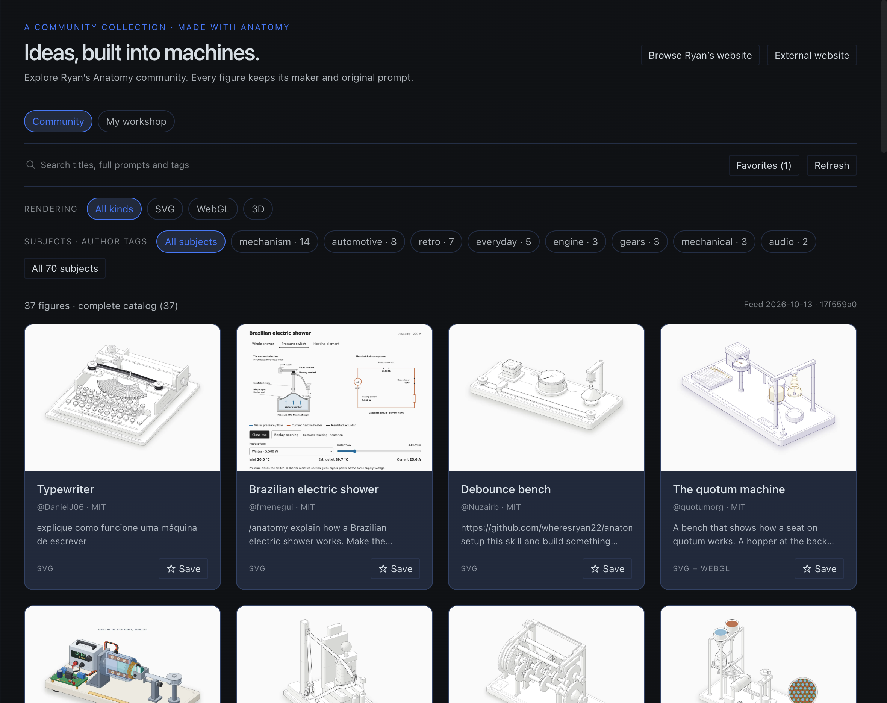
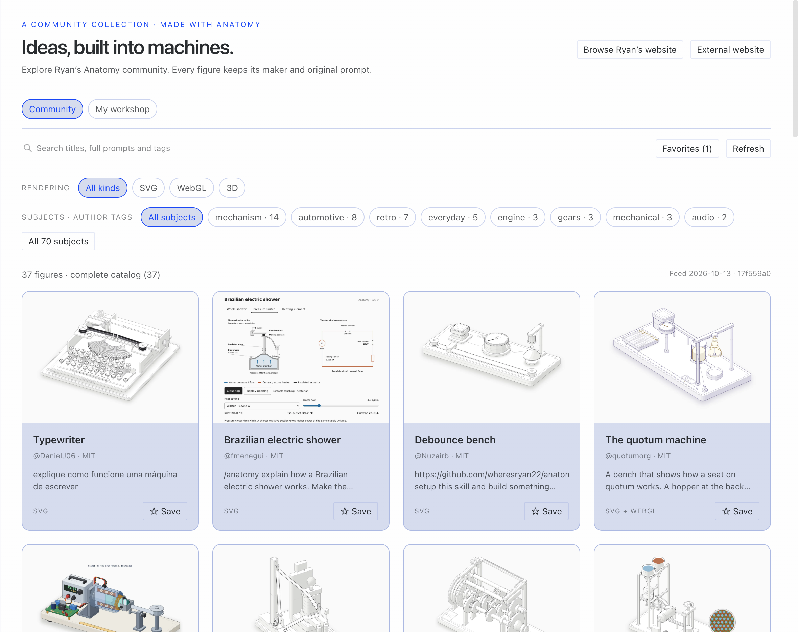

# Anatomy Museum

An opt-in, native **Hermes Desktop** gallery for Ryan / wheresryan22's [Anatomy community](https://skills.wheresryan.sh/anatomy/community): search original prompts, filter by author-supplied subjects and rendering kind, save local favorites, and explicitly play published standalone figures in an opaque sandbox.

This is the Hermes integration, not the Anatomy collection or a new community hosting service. Version **0.1.0** is a community release candidate, not a maintainer-approved catalog entry.

## Use

Enable **Desktop: Anatomy Museum** in **Capabilities → Plugins**. Open from the sidebar or the **Open Anatomy Museum** command palette action. Palette opening creates a closeable workspace tab; it does not create or send a chat.

- Search is case-insensitive contiguous substring matching over titles, full prompts and tags. Subject filters use creators' tags, separate from SVG / WebGL / 3D. Suggestions are not matches.
- Details retain author, original prompt, license, exact identity and immutable repository provenance.
- **Open figure in Hermes** fetches the licensed published standalone page only when clicked. Back removes the guest. Retry is explicit. A document-load label does not certify drawing or controls.
- Favorites and remembered filters stay in Desktop-local SDK storage, separately keyed by connection and profile. Unresolved owners do not load or save preferences.
- **My workshop** starts empty. Optionally enter an absolute file path on the frontend computer, then explicitly reveal it in the file manager. No inferred home path, example private instrument, local HTML execution, reading/copying or upload. The field is memory-only and resets when the page closes; it is not a remote-host path.
- Refresh is manual. Failed refresh preserves last-good memory data; errors, stale, verified-empty, incomplete catalogs and zero matches remain distinct. There is no offline disk catalog.

## Compatibility and installation

**macOS is the tested platform.** Requires Hermes Agent **>=0.21.6**, plus a matching native Desktop SDK providing `host.openWorkspace`, `host.paneVisibility`, connection/profile atoms, `ctx.storage`, `ctx.os`, `ctx.onDispose`, native UI/React Query and `SandboxedFrame` with opaque `data:` guest support. Those APIs and the unified-package discovery contract exist in the public **v0.21.6** source at [`818c13be1dc4fd28987e1e881a9408224afd4535`](https://github.com/NousResearch/hermes-agent/tree/818c13be1dc4fd28987e1e881a9408224afd4535). This is a source-contract floor, **not certification of every prebuilt Desktop release**. Native tests use a source-built Desktop reporting `0.0.0`; use a matching source build if your packaged app lacks these APIs. No guessed Desktop version number is claimed. Missing guarded APIs fail visibly; older/incompatible bundles are unsupported.

The tree is a real Desktop-only plugin package: `plugin.yaml` plus `desktop/plugin.js`. There is no Python backend, dependency install, server or plugin build step. Install the repository at its **reviewed full 40-character commit** using the standard installer:

```sh
hermes plugins install https://github.com/danrudy33/anatomy-museum --ref 6c2f3912b6af87d1149e38be523157057533d585 --no-enable
```

This command installs the published 0.1.0 release at its exact independently reviewed commit. After catalog acceptance, `hermes plugins install anatomy-museum --no-enable` uses the maintainer-reviewed catalog pin. Until then, use the repository URL rather than the bare catalog name.

After the command finishes:

1. Open **Capabilities → Plugins** in Hermes Desktop.
2. Click **Rescan**: the small **circular-arrow icon at the top-right of the installed-plugins section**, beside the folder icon and **Install from Git**. It is an icon-only button, not a button with the word Rescan printed on it; hover to see its **Rescan** tooltip. This lets an already-running Desktop discover and copy the package's Desktop half.
3. Find **Anatomy Museum** and enable its **Desktop** switch.
4. Open it from the sidebar or **⌘K → Open Anatomy Museum**.

### Stuck on “copying…”?

That label means the package is installed but its Desktop half has not yet been discovered/copied into the app. It is **not a live copy-progress indicator**, so waiting longer may not help. Click the **Rescan circular-arrow icon** once; when discovery finishes, the Desktop switch should replace the pending label. Then enable that switch. This resolved the actual recipient-install case without reinstalling, manually copying files or restarting Hermes.

No agent-side `hermes plugins enable anatomy-museum` command is needed for this UI-only package, and it is not a substitute for Desktop discovery and the Desktop switch. If Rescan does not resolve the pending label, report the error and your Desktop/backend connection setup rather than repeatedly reinstalling. A remote backend's package is not automatically a local frontend installation; use the supported **Install from Git** UI with the **Desktop** target for that case.

A Python capability probe may report that it was skipped because no `__init__.py` exists. Current `plugins doctor` assumes a Python entrypoint and can fail for this valid Desktop-only shape; `plugins validate` is the catalog admission gate. `plugins compat` is not available in the tested CLI. Do not add a dummy backend to conceal these tool limitations.

Disable the Desktop switch to remove contributions and cancel metadata/guest work. Remove the package with `hermes plugins remove anatomy-museum`; Desktop rescan/restart reconciles its managed copy. Removing code does not promise erasure of Desktop-local preferences. Rollback by disabling, removing, installing the prior reviewed exact commit with `--no-enable`, and enabling the Desktop switch. Do not overwrite unrelated plugins or delete chat/project records.

## Network, execution and storage disclosure

- On opening, metadata requests go to `api.github.com` and `raw.githubusercontent.com` for `wheresryan22/anatomy-community`. The previews branch is resolved to one immutable commit per refresh; built source provenance comes from its validated `BUILT_FROM` commit. Thumbnails load from that immutable raw GitHub tree. Site and license links also use `skills.wheresryan.sh`, `github.com`, `creativecommons.org` and `opensource.org`.
- Bounds: 240 figures, five pages, four detail workers, 2 MiB/page, 64 KiB/detail or branch, 16 KiB build-revision response, 15 seconds/request and 90 seconds/refresh. Larger collections are labeled incomplete, not absence. Fields, exact identity, URLs, revisions, counts, license and page/detail consistency are validated as untrusted data.
- Explicit standalone play fetches at most **4 MiB / 15 seconds**, verifies exact immutable provenance and UTF-8/MIME/doctype, and supplies unchanged HTML through the supported SDK `SandboxedFrame`. Community JavaScript executes **only as opaque guest content**, with `allow-scripts`, `no-referrer` and no same-origin, popup, navigation or download grants. It is never imported or evaluated as privileged plugin code. The reject-only standalone declaration check is not a general HTML sanitizer. The upstream standalone build contract and browser sandbox are separate controls. The guest is removed on Back/hide/unmount/owner change. HTML stays only in mounted-viewer memory, not a disk/code cache.
- **Browse Ryan's website is limited/unsupported for full embedded navigation and Play-with-it.** Website CSP and opaque-origin CORS can block its wrapper. The warning remains visible and external recovery is available. This is distinct from supported repository standalone playback; no CSP/CORS/certificate policy is bypassed.
- Network requests expose ordinary request metadata such as IP to those services; website guest subrequests remain subject to the host/browser policies. Metadata fetches omit credentials. No telemetry, stored credentials, credential-store reads, shell commands, background processes, polling, model prompts, automatic generation, automatic disk downloads, uploads, self-updater or remote plugin loader.
- The Desktop plugin itself runs with the app's normal renderer authority; the loader is not a capability sandbox. Only the **guest figure** has the opaque browser boundary. Local workshop reveal and external URL opening use curated SDK OS actions on explicit user gestures.

## Verification and limits

Portable checks (Node's standard library only; no npm install):

```sh
npm test
npm run check
hermes plugins validate . --install-deps
```

The source candidate has **23 deterministic tests**, including original catalog/standalone bounds and the public workshop portability change. Test helpers replace imports only in the unit harness; the shipped runtime uses the real SDK. Synthetic fixtures do not certify a live remote transition.

The exported runtime was also installed at an exact local Git commit using the official installer into a separate Hermes home. **12 bounded native package checks passed**: normal package discovery and disabled-by-default materialization, real 37/37 catalog load, search/clear, favorite/filter persistence, empty user-local workshop path and reset, all three standalone controls/containment checks, unsupported-site warning, plugin-only light/dark screenshots and disable/cache cleanup. No plugin exceptions or React key/hook warnings were observed. These are installed-package smoke checks, not whole-v1 or full-site acceptance.





Prior native verification of the same shared viewer certified **Wankel, Zipper and WebGL Ripple tank**, with actual author controls, numeric/geometry changes, animation and opaque containment; the catalog snapshot had **37/37** validated records. The other **34** figures were not individually interaction-certified. New release-package smoke evidence is recorded separately in the release handoff, not inferred from those historical results. Creator-published reduced-motion locks are preserved.

External browser/file-manager launches, remote/OAuth ownership transitions, actual CC-BY figures, long-duration use, screen readers, physical small devices, Linux/Windows and arbitrary older Desktop binaries are not certified. No conversational opener skill is advertised or shipped. No paid inference is required for browsing.

## Attribution

[Anatomy](https://github.com/wheresryan22/anatomy) is by **Ryan / wheresryan22**. The [community collection](https://github.com/wheresryan22/anatomy-community) and each figure remain credited to their authors under their own MIT or CC-BY-4.0 terms. Integration code: [MIT](LICENSE). See [THIRD_PARTY.md](THIRD_PARTY.md) for source/license details. This repository does not bundle community executable pages or thumbnail assets.
